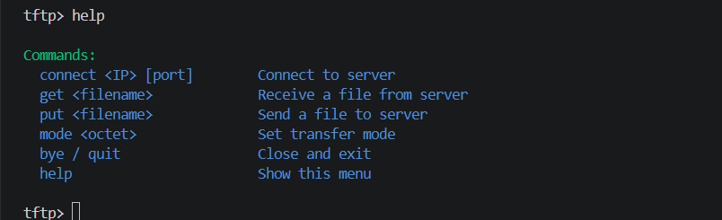
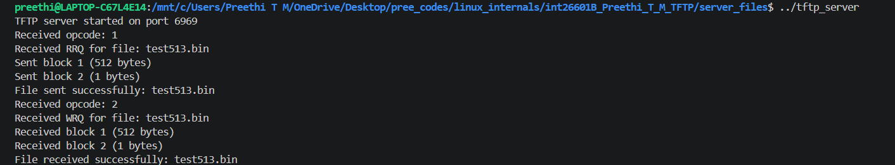

# TFTP Client-Server Implementation in C

**Developer:** Preethi T M  
**Batch:** int26001B  
**Domain:** Linux System Programming and Computer Networks

## Project Overview

Developed a Trivial File Transfer Protocol (TFTP) client-server application using C and UDP socket programming on Linux.

The application enables file uploads and downloads between a client and server using TFTP request, DATA, ACK and ERROR packets. It implements block-based data transfer, timeout and retransmission handling, and supports Octet transfer mode.

## Key Features

- **File Download (GET/RRQ):** Download files from the server to the client.
- **File Upload (PUT/WRQ):** Upload files from the client to the server.
- **Block-Based Transfer:** Transfers data in 512-byte blocks.
- **Acknowledgement Handling:** Uses ACK packets to confirm received data blocks.
- **Timeout and Retransmission:** Handles transfer timeouts and packet retransmission.
- **Duplicate DATA Handling:** Handles duplicate DATA packets during file transfer.
- **Error Handling:** Handles missing files and invalid transfer requests.
- **Transfer Modes:** Supports Octet mode.

## Technologies Used

- Programming Language: C
- Networking: UDP Sockets
- Protocol: TFTP
- Operating System: Linux (Ubuntu/WSL)
- Compiler: GCC

## Project Structure

```text
TFTP-Client-Server/
├── client_files/
├── server_files/
├── screenshots/
├── file.c
├── file.h
├── tftp.c
├── tftp.h
├── tftp_client.c
├── tftp_server.c
├── udp.c
├── udp.h
└── README.md
```

## Compilation

Compile both the TFTP server and client from the project root directory using the Makefile:

```bash
make
```

This generates two executable files:
- `tftp_server`
- `tftp_client`

To remove the generated executables:

```bash
make clean
```

## Execution

**1. Start the server**

Open a terminal and execute:

```bash
cd server_files
../tftp_server
```

**2. Start the client**

Open another terminal and execute:

```bash
cd client_files
../tftp_client
```

**3. Connect to the server**

At the client prompt, enter:

```bash
connect 127.0.0.1 6969
```

The server listens on UDP port `6969`.

You can now use the `get` and `put` commands to download and upload files.

## Client Commands

| Command | Description |
|---|---|
| `connect <IP> [port]` | Connect to the TFTP server |
| `get <filename>` | Download a file |
| `put <filename>` | Upload a file |
| `mode octet` | Set binary transfer mode |
| `help` | Display available commands |
| `bye` / `quit` | Exit the client |

## Screenshots

### Client Command Interface



### GET – File Download


### PUT – File Upload


### Server Output



## Key Learnings

- Gained practical experience with UDP socket programming and client-server communication.
- Understood TFTP packet formats, block numbers, DATA and ACK mechanisms.
- Implemented file handling, timeout management and retransmission logic.
- Improved debugging skills by handling packet loss, duplicate packets and file-transfer edge cases.
- Gained hands-on experience with Linux system programming and network protocol implementation.
